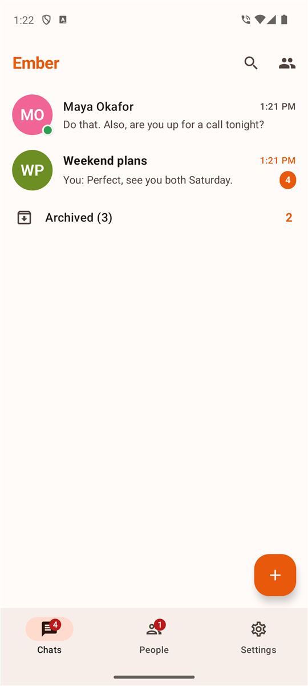
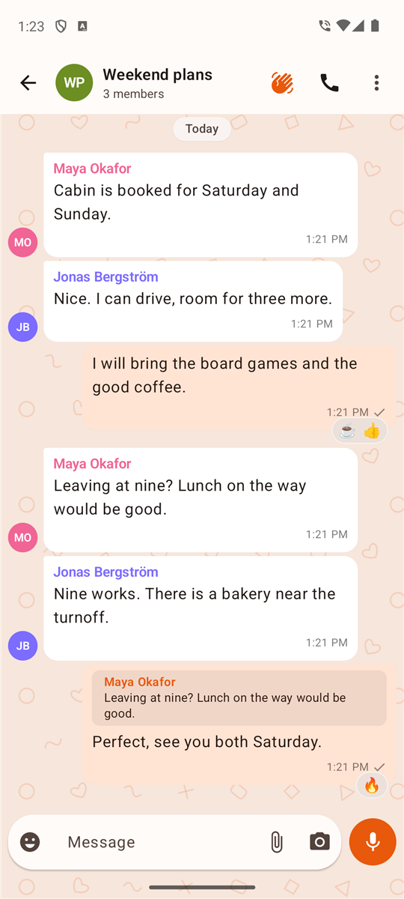
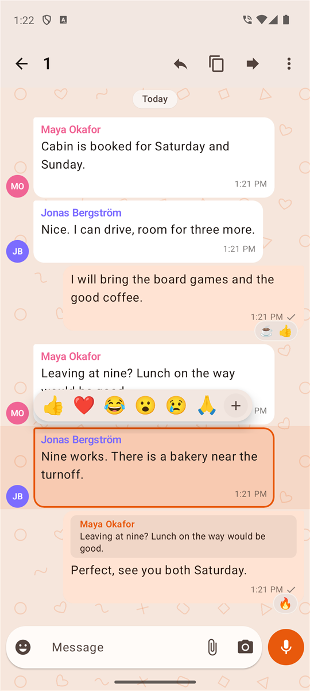
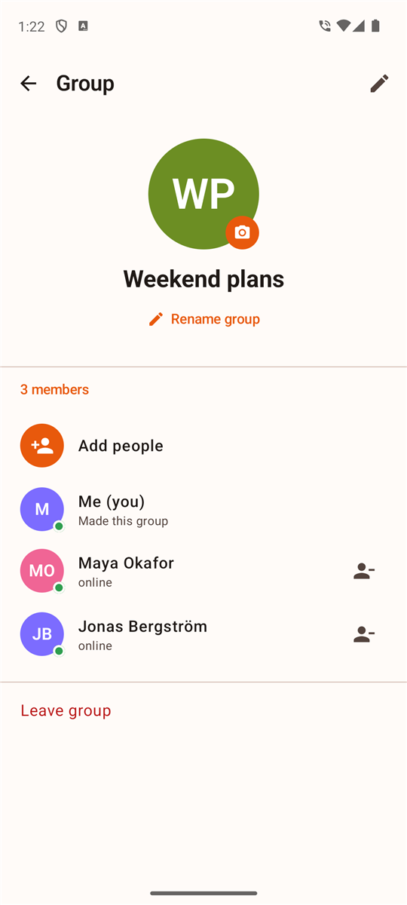
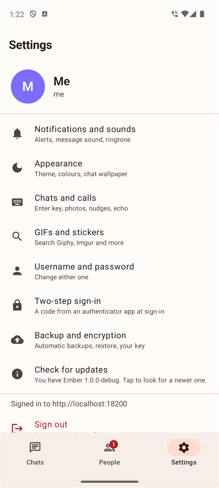
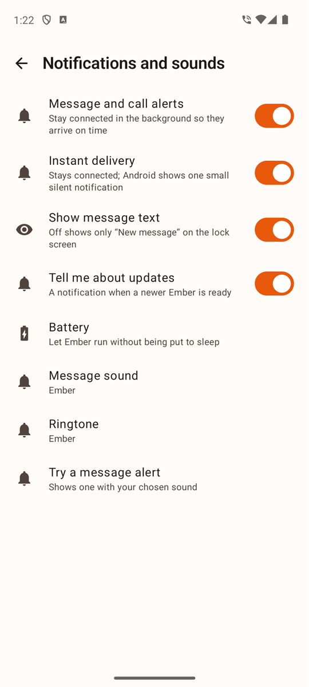
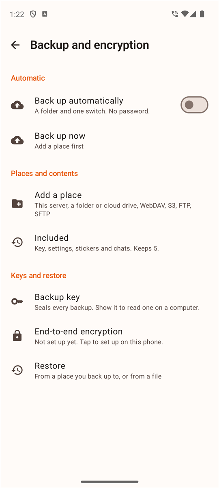
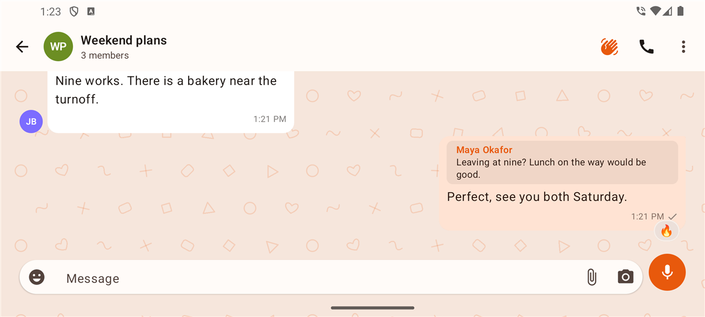
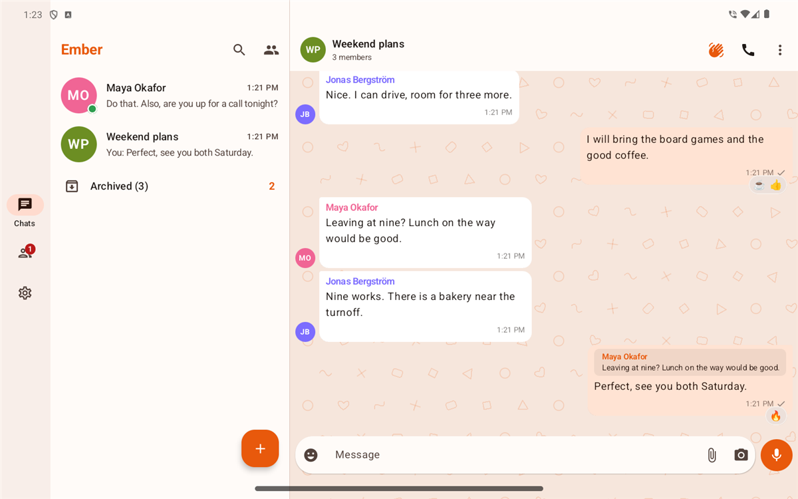

# Ember

Native Android messenger for a [Hearth server](https://github.com/modnite/hearth-server). Kotlin, Jetpack Compose, Material 3. Package `org.hearth.ember`, minSdk 26, targetSdk 35. Current version: 1.0.0.

<p>




</p>
<p>



</p>
<p>


</p>

## Install

1. Download `Ember-x.y.z.apk` from the [latest release](../../releases/latest).
2. Open it. Android asks once to allow installs from your browser or files app.
3. Enter your server address and sign in, or create an account.

Updates arrive through the app. Ember checks this repository's releases once an hour, posts one notification per version, and installs through Android's installer. Android only accepts an update signed with the same key as the installed app. The switch is under Settings, Notifications and sounds.

## Features

**Chats**
- Direct and group chats with replies, reactions, edits, pins, forwarding and nudges.
- Photos, videos, GIFs, stickers, files and voice notes. Photos and videos can be sent in HD or standard quality, with a caption.
- Stickers and GIFs from your own pictures, from Signal's public sticker packs, Google's animated Noto emoji, nekos.best and Wikimedia Commons. Giphy and Imgur work once you paste a key of your own. Searches go from the phone to the service directly.
- Group members can be added by anyone in the group and removed by whoever made it. Groups can be renamed and given a picture.
- Search by chat name and by message text.
- Spell check in the message box, using the spell checker selected in Android. The keyboard's own autocorrect is switched off in that field. Settings, Chats and calls, Test spell checking shows which spell checker the phone uses and what it marks in a sample sentence.
- Wallpapers: doodles in your accent colour, gradient, dots, plain, or a photo.

**Calls**
- One-to-one and group, voice and video, through LiveKit.
- Pre-call screen with camera lens choice and microphone check, screen sharing, audio output choice, picture in picture.
- Registered with Android Telecom, so Bluetooth headsets and watches can answer, mute and end a call.
- Low battery warnings: at 20, 15, 10 and 5 percent you get a notification and a banner telling you to plug in and use a fast charger, and the others in the call see "Name's battery is at 15%". The banner goes away when you plug in. Switch: Settings, Notifications and sounds, Low battery in calls.

**Accounts and privacy**
- Create an account from the sign-in screen. An invite code is used when the server needs one.
- Optional two-step sign-in with an authenticator app and recovery codes.
- Friend codes, contact requests, blocking, username and password changes.
- End-to-end encrypted chats (Hearth E2EE v2). Keys are set up per phone and chat text and files are sealed on the phone. Calls in encrypted chats use the same derived media key as the web client.

**Backups** (details in [docs/BACKUPS.md](docs/BACKUPS.md))
- Automatic backups at a time of day you choose, to any number of places: your Hearth server, a folder (including Google Drive, OneDrive, Proton Drive and Dropbox through their apps), WebDAV or Nextcloud, S3-compatible storage, FTP or FTPS, SFTP.
- Sealed with AES-256-GCM using a key your account holds. The key also sits in each backup under your account password.
- First sign-in on a new phone offers to restore the newest backup.
- The [Backup Reader](tools/backup-reader) opens backups on Windows, macOS and Linux.

**Crash reports**
- When Ember crashes it saves the report on the phone and sends it to your Hearth server at the next start, where an administrator reads it under Crashes. Nothing goes anywhere else. Settings, Chats and calls, Send crash reports switches it off.

**Notifications**
- Instant delivery keeps a connection open, which makes Android show one small silent notification. With it off, Ember checks every 15 minutes and calls do not ring while the app is closed.
- Messages (reply and mark as read from the shade), calls (answer or decline) and nudges.

**Layouts**
- Portrait, landscape, and a multi-pane layout for windows of 1000 dp or wider (tablets, Samsung DeX).
- Mouse right-click opens the message menu. Enter sends, Shift+Enter adds a line.
- Light and dark.

## How it works

- Talks to the Hearth server over its HTTP and WebSocket API ([docs/API.md](https://github.com/modnite/hearth-server/blob/main/docs/API.md)). Needs a server that has `GET /api/backup/key` and the group member routes. Hearth server 1.0.0 or later has both.
- Notifications use a foreground service that long-polls the server. No push provider is involved.
- Chat history for encrypted chats is searched on the phone.
- State lives on the phone and on your server. Nothing goes through other services except the optional sticker and GIF searches.

## Build

Needs JDK 17 and the Android SDK (compileSdk 35). LiveKit's audio helper comes from JitPack, which `settings.gradle.kts` must keep.

```bash
./gradlew assembleDebug        # app/build/outputs/apk/debug/app-debug.apk
./gradlew testDebugUnitTest
./gradlew assembleRelease      # signed with keystore.properties, else with the debug key
```

Signing, releasing and testing against a scratch server are in [docs/DEVELOPMENT.md](docs/DEVELOPMENT.md).

## Repository

| Path | Contents |
|---|---|
| `app/` | The Android app |
| `tools/backup-reader/` | Desktop Backup Reader (Compose Multiplatform) |
| `tools/open_archive.py` | Command line reader for archives |
| `docs/` | Backups, development notes, screenshots |
| `CHANGELOG.md` | One line per release |

## Milestones

| Version | Scope | State |
|---|---|---|
| 0.1 | Chats, calls, E2EE, notifications, in-app updates | Done |
| 0.2 to 0.3 | Camera, video, stickers, GIFs, call polish, nudges | Done |
| 0.4 to 0.6 | Backups with an account key, password-wrapped key, Backup Reader, wallpapers | Done |
| 0.7 to 0.8 | Open sign-up, two-step sign-in, friend codes, account changes, keyboard-safe settings | Done |
| 0.9 | S3, FTP and SFTP places, restore on first sign-in, group management, update notifier, spell check | Done |
| 1.0 | Stable release | Done |
| 1.1 | Low battery warnings in calls, crash reports to the server, spell check test | Done |

### Open items

- [ ] Which side of a call picture is flipped on Samsung front cameras (reported for your own preview and for other people's pictures, in Ember and in the web app). Needs a test on the phone
- [ ] Spell check confirmed on a Samsung phone (works on the emulator; use Test spell checking on the phone)
- [ ] Low battery messages from another phone seen on a second device (sending and the local warning are verified on the emulator)
- [ ] Hourly update check confirmed on a phone over several hours
- [ ] Emoji search keyboard handoff on Samsung phones (changed in 0.9.4, not confirmed on the phone that reported it)
- [ ] Viewing someone else's screen share (built, tested from the sharing side only)
- [ ] Calls in encrypted chats with Chromium and Safari clients (checked with Firefox and the native SDK)
- [ ] Search over encrypted chats beyond messages already loaded
- [ ] UnifiedPush
- [ ] XP-style theme
- [ ] Licence file (none yet)

## Credits

Nothing is copied from other messengers. Element X Android (AGPL) was read for patterns. If code from an AGPL project is ever copied in, Ember has to be released under the AGPL.
